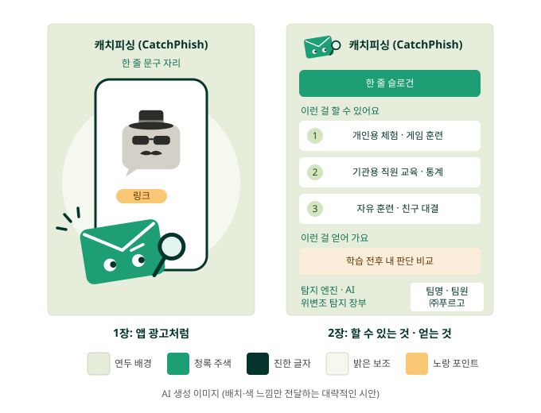
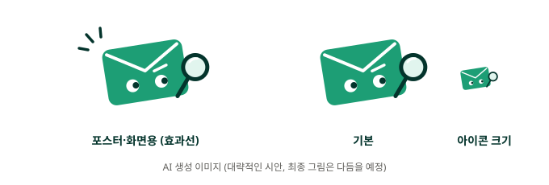

# 교내 경진대회 포스터

> 11/12 A 정리. 포스터는 이 문서만 보면 돼요. 흐름은 `교내경진대회_흐름.md`.
> 담당: B·C 제작, A 최종 확인 후 제출

---

## 구성 (작년 대상 팀 포스터 구성 참고, 디자인은 따라 하지 않기)

- **1장, 앱 광고처럼:** 맨 위 작품명 + 한 줄 문구. 가운데 큰 폰 화면 속에 작게 **변장한 수상한 문자**(중절모·선글라스·콧수염, 회색)와 링크. 앞쪽에 크게 **마스코트**가 돋보기를 들고 알아챈 모습. 글은 거의 없이
- **2장, 할 수 있는 것·얻는 것:** 위에 작은 마스코트 + 작품명, 슬로건 띠 / 할 수 있는 것 3칸 (개인용 체험·게임 훈련 / 기관용 직원 교육·통계 / 자유 훈련·순위표) / 얻어 가는 것 1칸 (학습 전후 내 판단 비교) / 아래 왼쪽에 작동 기술 한두 줄 / **오른쪽 아래 작은 칸에 팀명·팀원 학번·성명·㈜푸르고**

## 마스코트

- 청록 편지봉투, 살짝 기울어짐(갸웃), 눈은 곁눈질, 오른쪽 눈썹 하나 올림 ("음? 이거 진짜야?")
- 돋보기 렌즈는 봉투 오른쪽, 짧은 손잡이가 봉투 오른쪽 아래 모서리에 겹침
- 왼쪽 위 효과선 3개 ("어?" 알아챈 순간). 아이콘처럼 작게 쓸 때는 효과선 빼기
- 수상한 문자는 마스코트보다 작고 회색으로 (마스코트가 먼저 눈에 들어오게)
- 위 그림은 AI로 만든 대략적인 시안. 최종 그림은 이걸 바탕으로 다듬고, AI로 만든 그림을 그대로 쓰면 "AI 생성 이미지"로 표시

## 색 (5가지만)

| 색 | 쓰는 곳 |
|---|---|
| 채도 낮은 연두 | 배경 |
| 청록 | 마스코트, 슬로건 띠 |
| 진한 청록 | 제목, 글자 |
| 밝은 연두 | 1장 폰 뒤 큰 동그라미, 2장 번호 동그라미 |
| 노랑 (포인트) | **두 곳만:** 1장 링크, 2장 "얻어 가요" 칸 |

## 체크리스트
- 필수 표기: 작품명, 피시앤칩스(Phish&Chips), 팀원 전원 학번·성명, 작품 소개, ㈜푸르고 (이름만, 협업 내용 X)
- A1, 300dpi 이상, PDF 또는 고화질 PNG, 2장, **A에게 11/15(일) 20:00까지** (공식 11/16 15:00, 마감 뒤 수정 불가)
- QR 넣지 않기
- 지금 사이트 화면 캡처 쓰지 않기 (화면이 바뀌니까)
- 문자 속 링크·번호는 가짜 (`.example`, `010-0000-0000` 형식)
- 게임 이름은 정하지 말고 "훈련 게임", "순위표". 친구 대결(방 코드)은 시간이 남을 때만 만드니 포스터에 넣지 않기 (포스터는 마감 뒤 못 고침)
- 숫자를 넣는다면 `AI_인수인계.md` 값만, 다시 도전 결과는 "8명 규모의 시범 결과"로만
- AI로 만든 그림은 "AI 생성 이미지" 표시, 다른 캐릭터를 닮지 않게
- 한 줄 문구·슬로건은 정해서 전달 예정

---

마지막 수정: 11/12 (A). `교내경진대회_흐름과_포스터.md`에서 포스터 부분만 남기고 이름을 바꿈. "친구 대결" → "순위표" (방 코드는 조건부라).
