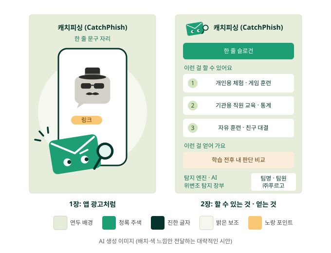
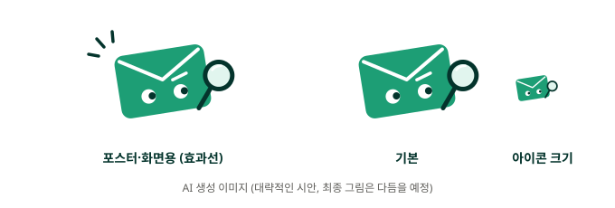

# 교내 경진대회 흐름과 포스터 정리 (A 제안, 팀 의견 필요)

> 11/10 A 작성. 아직 **제안**이에요. 의견은 단톡으로 주면 같이 정리해서 확정해요.
> 확정된 것만 `AI_인수인계.md`의 "지금 유효한 팀 결정"에 옮겨요.

---

## 0. 한 줄 요약

**진짜 문자·메일 같은 화면 + 처음 보는 어려운 문제로, 학습 전후를 비교해서 교육 효과를 숫자로 보여 준다.** 개인용에는 게임 훈련을 넣고, 게임만 하는 자유 훈련도 따로 둔다. PC와 폰 모두에서 잘 되게 만든다.

---

## 1. 흐름

**개인용 (학생·일반인)**
1. 첫 화면에서 [개인용]
2. 사전질문 (대상, 캐치피싱을 해 본 적 있는지, 자신감 등)
3. 사전 체험 4문제
4. 해설
5. 연쇄형 체험 (학습용, 아래 4번)
6. 게임 1개로 훈련
7. 사후 체험 4문제 (처음 보는 문제)
8. 결과: 두 점수(막은 피싱 / 처리한 업무) 전후 비교 + 보안 대응 수준

**기관용 (회사·기관 직원)**
1. 첫 화면에서 [기관용] → 기관 코드
2. 직군 선택 + 사전질문
3. 사전 체험 4문제 (공통 3 + 직군 1)
4. 해설 → 대응 매뉴얼 따라 쓰기
5. 연쇄형 체험 (학습용)
6. 사후 체험 4문제 (처음 보는 문제, 게임 없음)
7. 결과: 두 점수 전후 비교
8. 담당자는 관리자 화면에서 직군별 통계를 본다

**자유 훈련 (누구나)**
1. 첫 화면에서 [자유 훈련]
2. 체험 없이 바로 게임 (학생 접근성)
3. 별명으로 순위표에 올린다
4. 친구와 대결: **방 코드**(서로 다른 폰끼리)와 **화면 반 나누기**(한 태블릿에서 마주 보고) 둘 다, 각각 다른 게임으로. 시간이 부족하면 하나만
5. 게임 기록은 체험 장부와 교육 효과 숫자에 섞지 않는다

- **기관용에 게임이 없는 이유:** 기관은 직원 교육을 게임으로 하지 않고, 속도 경쟁은 나이 많은 직원에게 불리하다
- **전원이 사후 체험을 하는 이유:** 점수가 낮은 사람만 다시 하면, 그날 운이 나빠 틀린 사람은 공부를 안 해도 다음에 점수가 오르는 경우가 많아 효과가 실제보다 크게 보인다. 전원이 하면 운 좋게 만점 받았다가 내려가는 사람도 함께 들어가서 진짜 효과에 가까워진다
- **작품 설명서에서 자유 훈련:** "체험 없이 바로 시작할 수 있어 접근성이 좋고, 순위표와 친구 대결로 경쟁심을 이용한 반복 학습이 가능하다" (측정한 효과가 아니라 기대효과로 쓴다)
- **게임 효과:** "게임 하나의 효과"가 아니라 "해설 + 게임 훈련 뒤 전후 변화"로 말한다

---

## 2. 문제 구성

- **한 세트 4문제: 피싱 2 + 정상 2.** 우리 체험자의 가장 큰 약점이 과잉 의심(1차 71%, 2차 54%)이라 정상도 2개 넣어야 제대로 잰다
- **세트 A·B를 사람마다 무작위로** 사전·사후에 바꿔 낸다
- **몰입감:** 개인용은 대상별(학생용 소재: 장학금, 학교 공지, 택배, 중고거래, 알바), 기관용은 직군별 카드로 "나한테 올 법한 메시지"를 받게 한다
- **기관용 구성:** 직군 카드 1개는 피싱(지금 직군 카드 5개가 모두 피싱), 공통 3개는 피싱 1 + 정상 2

> **⚠️ 쌍둥이 카드: 세트 A와 B의 짝은 난이도가 최대한 같아야 한다.** 다르면 사전·사후 차이가 학습 효과인지 문제 차이인지 알 수 없다.
> - 같은 유형 (기관 사칭이면 둘 다 기관 사칭), 같은 종류 (문자/메일)
> - 단서 개수가 같게 (A에 이상한 점이 2개면 B도 2개)
> - 비슷한 길이
> - 탐지 엔진 점수가 비슷한 구간
> - 다 쓰면 짝끼리 나란히 놓고 "어느 쪽이 더 쉬운가?" 서로 확인

---

## 3. 필요한 시나리오 수

| 어디에 | 필요한 수 | 새로 만들 것 |
|---|---|---|
| 개인용 세트 A·B | 8 | **8개 모두 새로** |
| 기관용 공통 카드 A·B | 6 | 기존 공통·2회차 카드에서 골라 쓰기 (선택지 문구는 새로) |
| 기관용 직군 카드 A·B | 10 (직군 5 × 2) | 기존 5개 손보기 + **짝이 될 새 직군 카드 5개** |
| 연쇄형 (학습용) | 1 | 기존 S06을 크게 개선 |
| 게임 | 게임별 문제 데이터 | 게임 종류에 따라 정함 |

- **새로 만들 시나리오: 최소 13개** + 기존 카드 손보기
- 기존 직군 카드도 쉬운 문제(보낸 번호만 봐도 정답 등), 선택지 문구, 진짜 같은 화면을 새 기준에 맞춰야 한다
- 기관용을 예전 참여자에게 부탁하면 이미 본 문제라 더 필요하다

---

## 4. 연쇄형

- 「내일의 솔루션」 자료조사 때 정한 4유형 중 하나이고, 1차 때 많이 속은 유형(8회)이라 **우리 작품의 특징** → 뺄 수 없다
- 지금 연쇄형은 단계마다 수상한 게 바로 보여서 너무 쉽다 → **크게 개선해서 학습 단계에 넣는다** (제안)
- 개선 방향: 첫 연락은 링크도 요구도 없이 평범하게 (신뢰 쌓기) / 요구는 작은 것부터 점점 크게 / 진짜 같은 화면으로
- 학습 단계에 두면 쌍둥이 짝이 필요 없고, 기관용(해설만이라 학습이 약했음)에도 훈련 내용이 생긴다
- 학습 단계 연쇄형 기록은 **사전·사후 비교 통계에서 뺀다**

---

## 5. 문제를 어렵게 만드는 방법

지금 문제가 쉬운 이유: **문제 카드처럼 보여서 "판단해야 한다"는 게 티가 나고, 보낸 곳이나 선택지 글자만 봐도 정답이 보인다. 정답 선택지도 늘 같은 자리다.**

### ① 진짜 문자·메일 화면 (교수님 제안, 1순위)
- 메일은 진짜 앱처럼 **표시 이름만 보이고, 실제 주소는 눌러야 보이게** → 표시 이름 위장이 실제처럼 통한다
- 문자는 말풍선, 보낸 번호, 링크가 실제 문자처럼
- 억지로 어렵게 만든 게 아니라 **현실과 같아서 어려운 것**
- 특정 서비스의 로고·이름·디자인은 쓰지 않는다 (팀 결정 12번)
- 문자 화면 1개 + 메일 화면 1개 **틀만 만들고, 시나리오는 데이터로 갈아 끼운다**

### ② 메시지
- 보낸 곳과 요구가 어긋나게: 회사 주소처럼 보이는 피싱, 바깥 주소인 정상
- 지금은 피싱 문자가 모두 010, 정상은 회사 번호 → 섞기 (가짜 번호만)
- 정상 메시지에도 "오늘까지" 같은 급한 말 → 압박 문구만으로 판단 못 하게
- 판단 기준은 끝까지 **"요구하는 행동"과 "확인 경로"**. 단서는 반드시 본문 안에
- AI가 쓴 듯한 문체 다듬기

### ③ 선택지: 세 개 모두 "확인한다", 확인하는 길만 다르게

예시 문자: "[학사지원팀] 2학기 장학금 지급 계좌 확인이 필요합니다. 오늘 18시까지 아래 링크에서 계좌 정보를 다시 입력해 주세요."

| 값 | 지금 방식 (정답이 보임) | 바꾼 방식 |
|---|---|---|
| `click` | 링크를 누른다 | 링크로 들어가 학사지원팀 공지가 맞는지 확인한다 |
| `call` | 문자 속 번호로 전화한다 | 문자에 적힌 번호로 전화해 진짜 학사지원팀인지 확인한다 |
| `official` | 멈추고 따로 확인한다 | 학교 포털 앱을 열어 장학금 공지가 있는지 확인한다 |

- 사람들은 링크를 누를 때도 "확인하려고" 누른다 → 더 현실적이고, **"확인 경로가 어디인가"**를 정확히 묻는다
- 정상 메시지에서 늘 포털만 고르면 처리한 업무 점수가 떨어지니 "무조건 포털"로도 못 이긴다
- 세 문장 길이 비슷하게
- **화면에서 선택지 순서 섞기.** 서버 값(`click`/`call`/`official`)은 그대로라 서버·장부는 안 바뀐다
- (검토) 진짜 같은 화면에서 선택지 버튼 없이 **링크를 누르면 `click`, 번호를 누르면 `call`, [나가서 확인하기]를 누르면 `official`**

### ④ 확인
- 링크는 `/check`, 메일은 이메일 엔진에 넣어 점수 확인
- 다 만든 뒤 팀원끼리 서로 풀어 보고 너무 쉽거나 억지스러운 카드 고치기

---

## 6. 모바일

- 전시 관람객과 시범 운영 참여자 대부분이 **폰으로 한다.** 지금은 PC 기준이라 폰에 맞춰야 한다
- 진짜 문자·메일 화면은 원래 폰 모양이라 **폰 기준으로 만들고, PC에서는 가운데에 폰 화면처럼** 보여 준다
- 볼 것: 글자·버튼 크기, 해설 길이, 따라 쓰기(폰에서 긴 문장 치기 힘듦), 제한 시간, 게임 카드 크기
- 관리자 화면은 담당자가 PC로 보니까 우선순위 낮음
- 검수 때 **실제 폰(아이폰·안드로이드)으로** 확인

---

## 7. 일정

| 날짜 | 할 일 |
|---|---|
| 11/15(일) | 포스터 최종 파일 |
| 11/17(화) | 참가신청서 및 동의서 |
| 11/19(목) | 개인용·기관용 체험, 게임, 모바일까지 완성 → 검수 |
| 11/20(금)부터 11/22(일)까지 | 3차 시범 운영. **이 기간에는 배포 금지** (오탈자만) |
| 11/23(월) | 교수님 피드백 |
| 11/26(목) | 작품 설명서. **자유 훈련(순위표, 친구 대결) 포함 완성된 상태로** |

- 자유 훈련은 시범 운영 중 배포 금지라 **11/19까지 함께 올리거나 11/23에서 11/25 사이에** 올려야 한다. 11/23부터 11/26까지는 피드백 반영과 겹쳐서 11/19까지가 안전하다
- 전시는 작품 설명서와 같은 완성본으로 한다 (규정 확인 중)

---

## 8. 포스터

### 구성 (작년 대상 팀 포스터 구성 참고, 디자인은 따라 하지 않기)

- **1장, 앱 광고처럼:** 맨 위 작품명 + 한 줄 문구. 가운데 큰 폰 화면 속에 작게 **변장한 수상한 문자**(중절모·선글라스·콧수염, 회색)와 링크. 앞쪽에 크게 **마스코트**가 돋보기를 들고 알아챈 모습. 글은 거의 없이
- **2장, 할 수 있는 것·얻는 것:** 위에 작은 마스코트 + 작품명, 슬로건 띠 / 할 수 있는 것 3칸 (개인용 체험·게임 훈련 / 기관용 직원 교육·통계 / 자유 훈련·친구 대결) / 얻어 가는 것 1칸 (학습 전후 내 판단 비교) / 아래 왼쪽에 작동 기술 한두 줄 / **오른쪽 아래 작은 칸에 팀명·팀원 학번·성명·㈜푸르고**

### 마스코트

- 청록 편지봉투, 살짝 기울어짐(갸웃), 눈은 곁눈질, 오른쪽 눈썹 하나 올림 ("음? 이거 진짜야?")
- 돋보기 렌즈는 봉투 오른쪽, 짧은 손잡이가 봉투 오른쪽 아래 모서리에 겹침
- 왼쪽 위 효과선 3개 ("어?" 알아챈 순간). 아이콘처럼 작게 쓸 때는 효과선 빼기
- 수상한 문자는 마스코트보다 작고 회색으로 (마스코트가 먼저 눈에 들어오게)
- 위 그림은 AI로 만든 대략적인 시안. 최종 그림은 이걸 바탕으로 다듬고, AI로 만든 그림을 그대로 쓰면 "AI 생성 이미지"로 표시

### 색 (5가지만)

| 색 | 쓰는 곳 |
|---|---|
| 채도 낮은 연두 | 배경 |
| 청록 | 마스코트, 슬로건 띠 |
| 진한 청록 | 제목, 글자 |
| 밝은 연두 | 1장 폰 뒤 큰 동그라미, 2장 번호 동그라미 |
| 노랑 (포인트) | **두 곳만:** 1장 링크, 2장 "얻어 가요" 칸 |

### 체크리스트
- 필수 표기: 작품명, 피시앤칩스(Phish&Chips), 팀원 전원 학번·성명, 작품 소개, ㈜푸르고 (이름만, 협업 내용 X)
- A1, 300dpi 이상, PDF 또는 고화질 PNG, 2장, 팀 마감 11/15(일)
- QR 넣지 않기
- 지금 사이트 화면 캡처 쓰지 않기 (화면이 바뀌니까)
- 문자 속 링크·번호는 가짜 (`.example`, `010-0000-0000` 형식)
- 게임 이름은 정하지 말고 "훈련 게임", "친구와 대결"
- 숫자를 넣는다면 `AI_인수인계.md` 값만, 다시 도전 결과는 "8명 규모의 시범 결과"로만
- AI로 만든 그림은 "AI 생성 이미지" 표시, 다른 캐릭터를 닮지 않게
- 한 줄 문구·슬로건은 정해서 전달 예정

---

## 9. 좋은 점

- 전원이 사전·사후를 해서 **교육 효과가 숫자로** 나온다 (심사 4번 교육성과 25점)
- 1·2차 시범 운영 한계(표본 작음, 1·2회차 난이도 차이, 결과 화면 긺)를 고친 게 보인다
- 정상 2개라 **과잉 의심 변화**를 제대로 잴 수 있다
- 진짜 같은 화면이라 체험이 덜 시험 같고, 문제도 자연스럽게 어려워진다
- 개인용·기관용 뼈대가 같아서 만들기 쉽다
- 지금보다 짧다 (최대 10문제 → 8문제)
- 학생·일반인 확장 + 자유 훈련 → 심사 2번(지역사회)·6번(확산) 근거
- 게임 점수가 장부와 따로라 해시체인과 기존 통계가 안 깨진다

## 10. 걱정되는 점

- **새 시나리오 부담이 크다** (최소 13개 + 기존 카드 손보기 + 연쇄형 개선). 가장 큰 위험
- 화면 작업이 크게 늘어난다 (진짜 같은 화면 + 모바일 + 대결 2종)
- 쌍둥이로 만들어도 세트 A·B 난이도가 완전히 같지는 않다
- 기관용 참여자가 적으면 기관용 숫자는 몇 건 안 나올 수 있다
- 개인용은 해설 + 게임이 함께라 게임 하나의 효과만 따로 증명하기 어렵다
- 짧은 훈련이라 변화가 작을 수 있다. 막은 피싱은 이미 높다 (다시 도전 8명 규모의 시범 결과 83% → 83%)
- 사후 체험에서 일부러 다 의심할 수 있다 (두 점수에 드러나긴 함)
- 직군 카드가 늘 피싱이면 눈치 빠른 사람은 알아챌 수 있다 (한 사람이 2개만 봐서 크진 않음)
- 문제를 어렵게 하다 억지스러워질 수 있다

---

## 11. 꼭 해야 할 일

**문제 [B]**
- 개인용 새 시나리오 8개, 기관용 새 직군 카드 5개
- 기존 공통·직군 카드 손보기
- 연쇄형 개선
- 모든 카드 선택지 문구 새로 쓰기
- 쌍둥이 짝 표, 탐지 엔진 점수 확인
- 게임 문제 데이터

**화면 [A, B]**
- 진짜 문자·메일 화면 틀 2개
- 첫 화면: 개인용 / 기관용 / 자유 훈련
- 사전질문 2개 추가 (대상, 해 본 적 있는지)
- 선택지 순서 섞기
- 모바일 맞추기
- 게임 (A 예시 → B 화면)
- 화면 반 나누기 대결

**서버 [A]**
- 개인용·기관용 나누기, 세트 A·B 무작위 배정
- 게임 점수 저장, 순위표와 조작 방지, 방 코드 대결

**장부·통계 [C]**
- 장부 새 칸(세트, 사전/사후, 대상, 재참여 등)이 들어가도 [기록 검사]가 정상인지 시험
- 통계: 사전·사후 비교, 대상별, 재참여 여부별. 학습 단계 연쇄형 기록은 비교에서 빼기
- 관리자 화면에 새 숫자 표시
- 완성본 검수 (실제 폰 포함)

**포스터 [B, C]**
- 위 8번대로 2장, 11/15(일)

---

## 12. 의견 주세요 (팀 논의)

1. 개인용 게임 1개는 무엇으로? 과잉 의심을 줄이려면 정상이 섞인 게임(편지봉투, OX)이 유리하고, 교수님이 교육 효과가 좋았다고 보여 준 건 카드 짝맞추기
2. 만점자도 사후 체험? 제안: 전원 (이유는 1번 흐름 아래)
3. 보안 대응 수준은 개인용에만?
4. 연쇄형을 개선해서 학습 단계에 넣는 것 (제안)
5. 폰에서 따라 쓰기 문장 길이, 제한 시간을 바꿀지
6. 선택지 버튼 대신 진짜처럼 링크·번호를 누르게 할지
7. 전시 때 체험 링크 QR: 태블릿에 띄우기 vs 크게 출력해서 붙이기
8. 마스코트·포스터 시안 의견

---

마지막 수정: 11/10 (A). 처음 작성.
